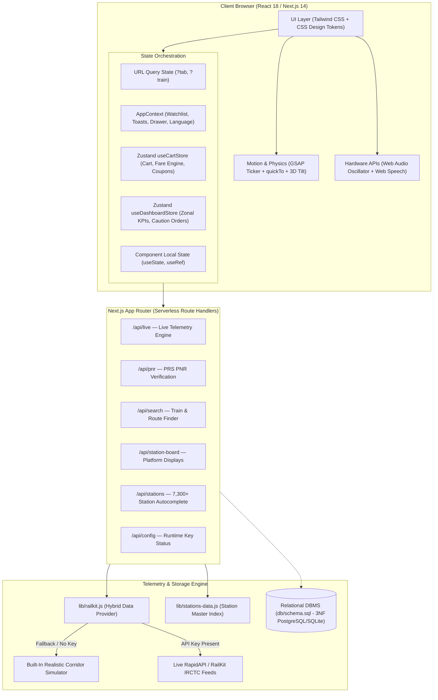
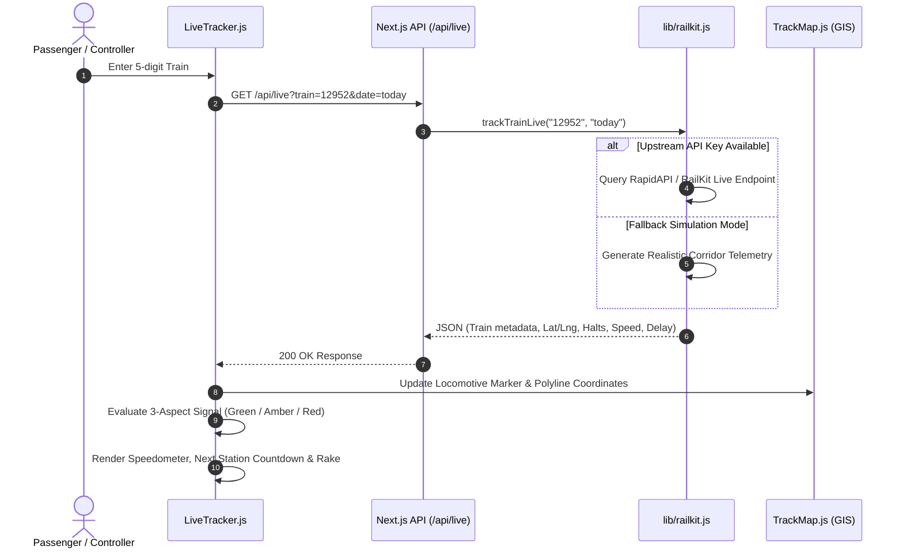
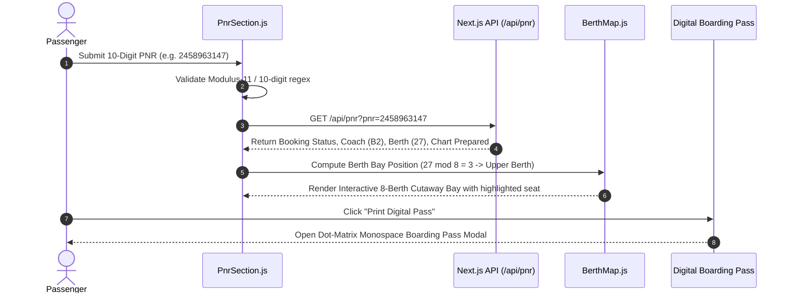
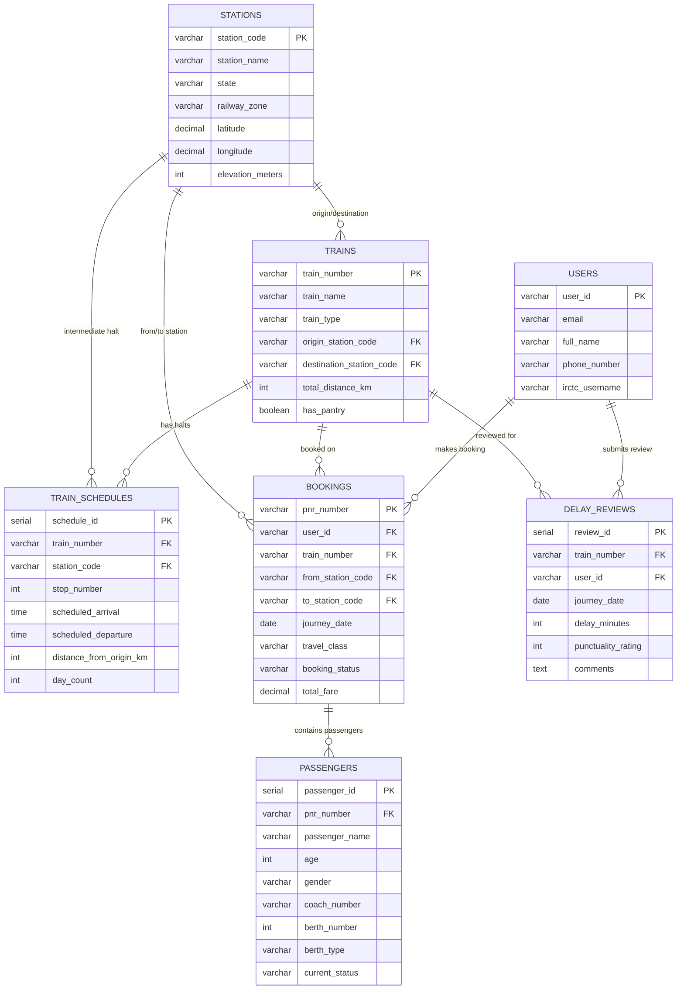

# RailSync 🚂 — System Architecture & Engineering Blueprint

RailSync is a modern, full-stack Indian Railways telemetry, PRS passenger reservation, and route intelligence platform. This document outlines the end-to-end architecture, component hierarchy, data pipelines, state topology, and relational database schema.

---

## 1. High-Level Architectural Topology

---

## 2. Layer-by-Layer Architectural Breakdown

### Layer 1: Presentation & Design System
- **Framework**: React 18 with Next.js 14 App Router.
- **Styling**: Tailwind CSS utility classes augmented with custom railway CSS design tokens in `app/globals.css`.
- **Theme Tokens**: Dynamic dual-mode tokens via CSS variables:
  - `--station-yellow` (`#FFD200`): Primary accent, station signage yellow.
  - `--signal-green` (`#10B981`): Right Time / Line Clear ($0\text{--}5\text{ mins}$ delay).
  - `--signal-amber` (`#F59E0B`): Caution ($5\text{--}25\text{ mins}$ delay).
  - `--signal-red` (`#EF4444`): Danger / Significant delay ($> 25\text{ mins}$).
  - `--bg-canvas`, `--bg-surface`, `--border-main`: Contrast tokens for dark and light palettes.
- **Typography**: 
  - `JetBrains Mono` for telemetry HUDs, train numbers, station codes, and PRS chart text.
  - `Plus Jakarta Sans` for body copy, modal interfaces, and editorial cards.

### Layer 2: Interactive Motion & Physics Layer
- **`CustomCursor.js`**:
  - Dual-layer pointer: instant 6px dot + smooth trailing 36px ring via `gsap.quickTo`.
  - Magnetic snapping to interactive elements.
  - Morphing into elongated contextual pills (`data-cursor="EXPLORE"`, `data-cursor="TRACK"`).
  - Hardware safe: automatically deactivates on touch screens via `(pointer: fine)` media query.
- **`SignalField.js`**:
  - HTML5 Canvas background running on `gsap.ticker`.
  - Simulates 40 particles bouncing off viewport boundaries.
  - 130px glowing connective lines between adjacent nodes.
  - 165px pointer magnetism force field.
  - Automatically suspends animation loop when tab is hidden via `document.addEventListener('visibilitychange')`.
- **`useTiltCard.js`**:
  - React hook calculating cursor position relative to card bounding rect.
  - Smoothly maps offset to $\pm 10^\circ$ `rotateX` / `rotateY` with `perspective: 1000px`.
  - Dampens back to zero on mouse leave.
- **`StereoscopicTitle.js` & `RandomLogoArrival.js`**:
  - High-contrast display typography utilizing `Abril Fatface` with offset overprint shadow layer, pointer parallax, and GSAP spring pop on hover.
  - Dual-theme color grading: deep ink slate (`#0f172a`) in light mode, crisp pure white in dark mode.
  - Randomized vector trajectory entry with elastic landing dampening for the locomotive logo.

### Layer 3: Application State Management Topology
The state is partitioned into 4 distinct tiers to ensure optimal rendering performance and separation of concerns:

1. **URL State Synchronization (`window.history.pushState`)**:
   - Handles tab navigation (`?tab=live`) and train deep-linking (`?train=12952`).
   - Listens to `popstate` to support browser back and forward history buttons seamlessly.
2. **Global Context API (`context/AppContext.js`)**:
   - Manages application-wide session state:
     - `watchlist`: Saved trains for live tracking.
     - `savedPnrs`: Bookmarked passenger tickets.
     - `activePnrQuery`: Deep-link PNR identifier for automated status verification.
     - `toasts`: Dynamic notification stack with auto-dismiss timers.
     - `emergencyDrawerOpen`: SOS emergency support drawer toggle.
     - `language`: Cycle through English, Hindi, and Regional options.
3. **Zustand Domain Stores (`store/`)**:
   - `useCartStore.js`: Journey booking cart with item management, telescopic fare calculations, discount coupon application (`RAIL10`, `STUDENT20`), and `persist` middleware saving to `localStorage`.
   - `useDashboardStore.js`: Operational Control Desk state tracking 13,000+ rakes, network punctuality ratings (91.4%), zonal filters, active caution orders, and simulated background polling.
4. **Local Component State (`useState`, `useRef`)**:
   - Transient state such as form inputs, active dropdowns, and animation references.

### Layer 4: Client-Side Native Hardware Web APIs
- **Web Audio API (`lib/audio-chime.js`)**:
  - Mathematical oscillator synthesis of the authentic Indian Railways 4-tone station chime:
    $$\text{Tones: } G_4 (392.00\text{ Hz}) \longrightarrow C_5 (523.25\text{ Hz}) \longrightarrow D_5 (587.33\text{ Hz}) \longrightarrow G_5 (783.99\text{ Hz})$$
  - Each note uses exponential gain ramping for acoustic decay without audio distortion.
- **Web Speech API**:
  - Synthesizes dynamic public address voice announcements in Hindi (*"यात्री कृपया ध्यान दें..."*) and English (*"May I have your attention please..."*).

### Layer 5: Backend Serverless Route Handlers (`app/api/*`)
- `GET /api/live`: Ingests train number and date; returns telemetry, speed, coordinates, halt schedules, and signal aspect.
- `GET /api/pnr`: Validates 10-digit PNR; returns charting status, train name, passenger berth allocations, and confirmation probability.
- `GET /api/search`: Looks up trains running between any two station codes with departure/arrival timings and classes.
- `GET /api/station-board`: Fetches live station platform arrivals and departures with 2h, 4h, and 8h lookahead windows.
- `GET /api/stations`: Delivers instant prefix search and autocomplete across 7,300+ stations.
- `POST /api/config`: Configures runtime API keys dynamically.

### Layer 6: Data Provider & Telemetry Engine (`lib/railkit.js`)
- **Two-tier hybrid bridge**:
  - If a valid `RAILKIT_API_KEY` is present, passes requests to upstream RapidAPI / RailKit endpoints.
  - If no key is set or upstream network fails, seamlessly falls back to the internal realistic corridor simulator.
  - Implements circuit breaker behavior preventing unhandled exceptions and infinite loading spinners.

---

## 3. Data Pipelines & Sequence Diagrams

### 3.1 Live Train Telemetry Sequence

### 3.2 PNR Verification & 8-Berth Schematics Sequence

---

## 4. Relational Database Architecture (DBMS)

The database schema defined in [`db/schema.sql`](file:///Users/akshit/Desktop/coding/fee%20and%20dbms%20project/db/schema.sql) is designed in **3rd Normal Form (3NF)** with strict referential integrity, foreign key cascades, and performance indexes.

### 4.1 Entity-Relationship (ER) Diagram

### 4.2 Relational Normalization Analysis (3NF Compliance)

1. **First Normal Form (1NF)**:
   - All columns contain atomic, indivisible values.
   - Each table possesses a designated primary key (`station_code`, `train_number`, `pnr_number`, `user_id`).
   - Repeating groups (e.g. passengers per booking, halts per train) are normalized into independent child tables (`passengers`, `train_schedules`).
2. **Second Normal Form (2NF)**:
   - 1NF is satisfied.
   - No non-prime attribute is functionally dependent on a subset of any candidate composite key. In `train_schedules`, each stop is identified by `(train_number, stop_number)` or surrogate `schedule_id`.
3. **Third Normal Form (3NF)**:
   - 2NF is satisfied.
   - Zero transitive dependencies: non-key attributes depend solely on the primary key ($X \to Y$ where $X$ is a superkey). For example, `station_name` and `railway_zone` depend exclusively on `station_code` in `stations`, rather than being duplicated in `bookings` or `trains`.

---

## 5. Security, Caching & Resilience Model

- **API Key Sequestration**: Upstream API credentials reside exclusively on the server side (`process.env.RAILKIT_API_KEY`). Browser clients never receive or transmit external API secrets.
- **In-Memory Cache Layer**: Station lookup structures (`stations-data.js`) are pre-indexed into memory trees for $O(1)$ code lookups and sub-millisecond prefix searches.
- **Resilient Circuit Breaker**: Upstream failures automatically trigger cached/simulated response generation, preventing application crashes.
- **Input Sanitization & Validation**:
  - Train numbers validated against `/^\d{5}$/`.
  - PNR numbers validated against `/^\d{10}$/`.
  - Station inputs sanitized against uppercase alphanumeric codes.
