# RailSync 🚂 — End-to-End System Flow & Workflow Execution Guide (`FLOW.md`)

This document is the master operational flow manual for **RailSync**. It maps every user journey, internal data pipeline, state transition, visual physics loop, audio synthesis sequence, and database interaction across the entire platform.

---

## Table of Contents

1. [Application Boot & Initialization Flow](#1-application-boot--initialization-flow)
2. [SPA Navigation & URL State Synchronization Flow](#2-spa-navigation--url-state-synchronization-flow)
3. [Feature Workflow 1: Live GPS Train Telemetry](#3-feature-workflow-1-live-gps-train-telemetry)
4. [Feature Workflow 2: Train & Corridor Route Search](#4-feature-workflow-2-train--corridor-route-search)
5. [Feature Workflow 3: Platform Electronic Split-Flap Display Board](#5-feature-workflow-3-platform-electronic-split-flap-display-board)
6. [Feature Workflow 4: IRCTC PRS PNR Status & 8-Berth Cutaway Schematics](#6-feature-workflow-4-irctc-prs-pnr-status--8-berth-cutaway-schematics)
7. [Feature Workflow 5: Telescopic Fare Matrix & Journey Shopping Cart](#7-feature-workflow-5-telescopic-fare-matrix--journey-shopping-cart)
8. [Feature Workflow 6: Control Desk Operational Center](#8-feature-workflow-6-control-desk-operational-center)
9. [Feature Workflow 7: Watchlist & Saved PNR Management](#9-feature-workflow-7-watchlist--saved-pnr-management)
10. [Feature Workflow 8: RailMadad 139 Emergency Helpline Desk](#10-feature-workflow-8-railmadad-139-emergency-helpline-desk)
11. [Interactive Motion, Canvas & Physics Flows](#11-interactive-motion-canvas--physics-flows)
    - [Custom Cursor & Magnetic Follower Flow](#custom-cursor--magnetic-follower-flow)
    - [3D Perspective Card Tilt Flow](#3d-perspective-card-tilt-flow)
    - [SignalField HTML5 Canvas Particle Flow](#signalfield-html5-canvas-particle-flow)
    - [Scroll Progress & Scroll-to-Top Flow](#scroll-progress--scroll-to-top-flow)
12. [Hardware Audio & Bilingual Speech Synthesis Flow](#12-hardware-audio--bilingual-speech-synthesis-flow)
13. [Resilience & Fallback Simulation Decision Flow](#13-resilience--fallback-simulation-decision-flow)
14. [DBMS Relational Transaction & Query Pipeline](#14-dbms-relational-transaction--query-pipeline)

---

## 1. Application Boot & Initialization Flow

When a user visits RailSync, the browser executes the following boot sequence:

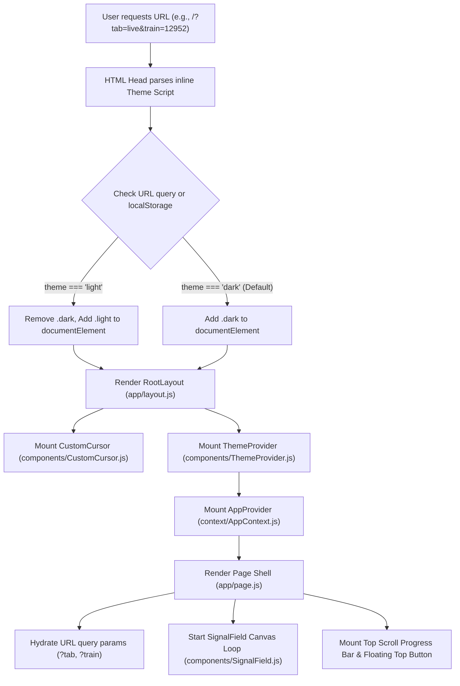

### Step-by-Step Execution:
1. **Zero-FOUC Theme Resolution**: The inline `<script>` in `app/layout.js` executes synchronously before HTML body rendering. It inspects `?theme=` query parameters, falls back to `localStorage.getItem('railsync_theme')`, and immediately applies `.dark` or `.light` to `<html>`.
2. **Global Wrappers**: `ThemeProvider` and `AppProvider` wrap the application, initializing global toast arrays, saved train watchlists, language state, and audio chimes.
3. **SPA State Hydration**: `app/page.js` runs `useEffect` on mount to extract `tab` and `train` query parameters and set the active view accordingly.

---

## 2. SPA Navigation & URL State Synchronization Flow

RailSync functions as a client-side Single Page Application with deep-linked state synchronization.

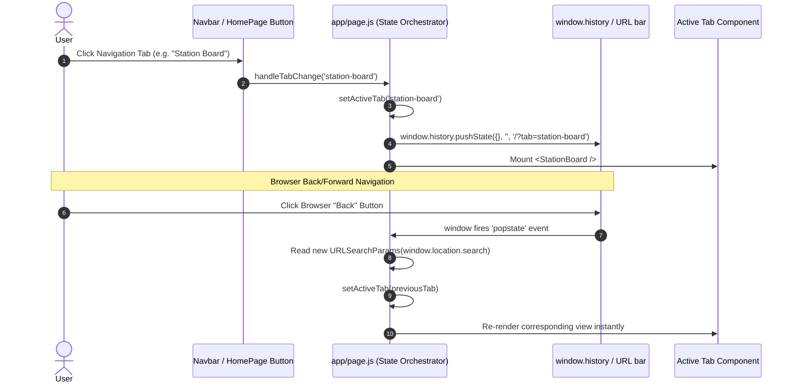

---

## 3. Feature Workflow 1: Live GPS Train Telemetry

Tracks 13,000+ trains with live speed, coordinates, signal aspect lamps, and intermediate halt ribbons.

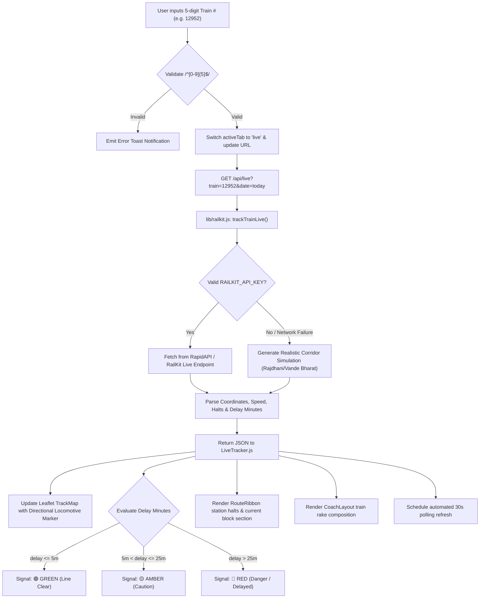

---

## 4. Feature Workflow 2: Train & Corridor Route Search

Dual-mode engine to find trains between any two stations or look up specific train schedules.

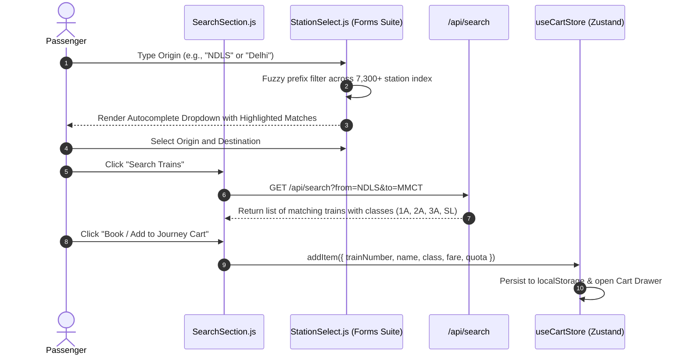

---

## 5. Feature Workflow 3: Platform Electronic Split-Flap Display Board

Emulates station platform displays with lookahead windows and public address announcements.

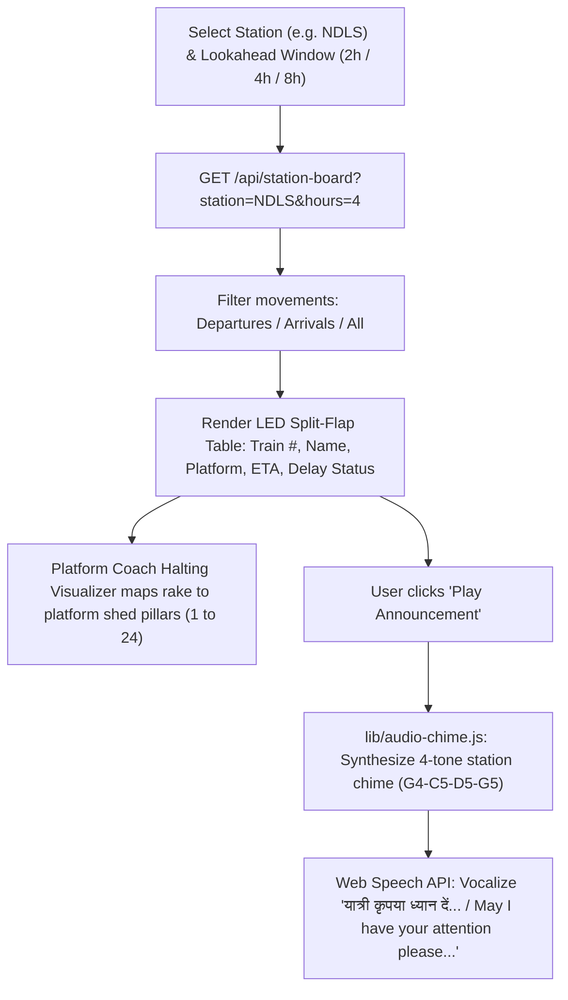

---

## 6. Feature Workflow 4: IRCTC PRS PNR Status & 8-Berth Cutaway Schematics

Verifies 10-digit PNR ticket numbers and provides visual compartment cutaways.

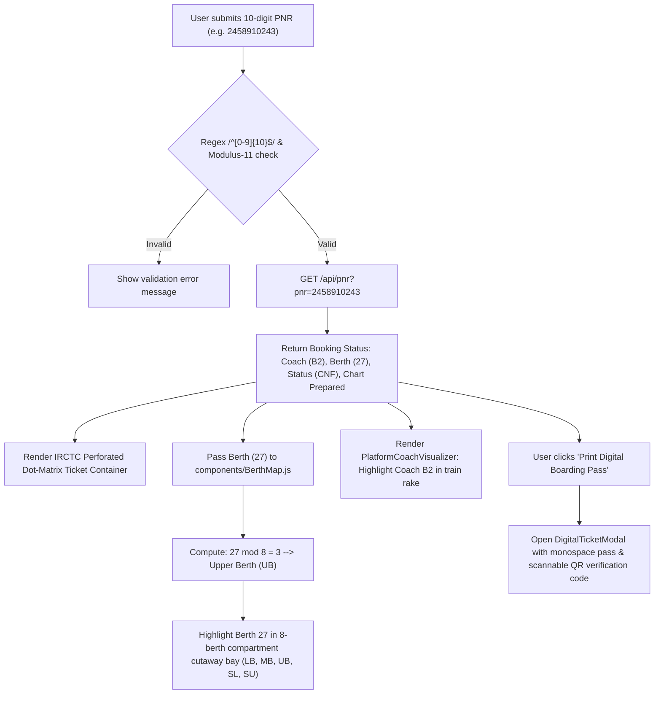

---

## 7. Feature Workflow 5: Telescopic Fare Matrix & Journey Shopping Cart

Dynamic distance-based fare calculation combined with Zustand cart management.

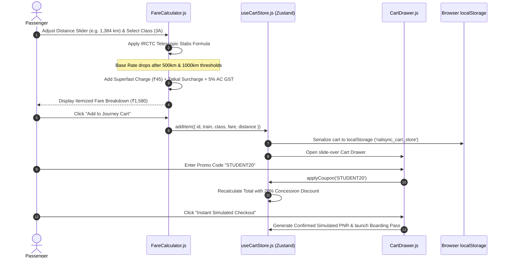

---

## 8. Feature Workflow 6: Control Desk Operational Center

Executive railway telemetry monitoring with asynchronous state modeling.

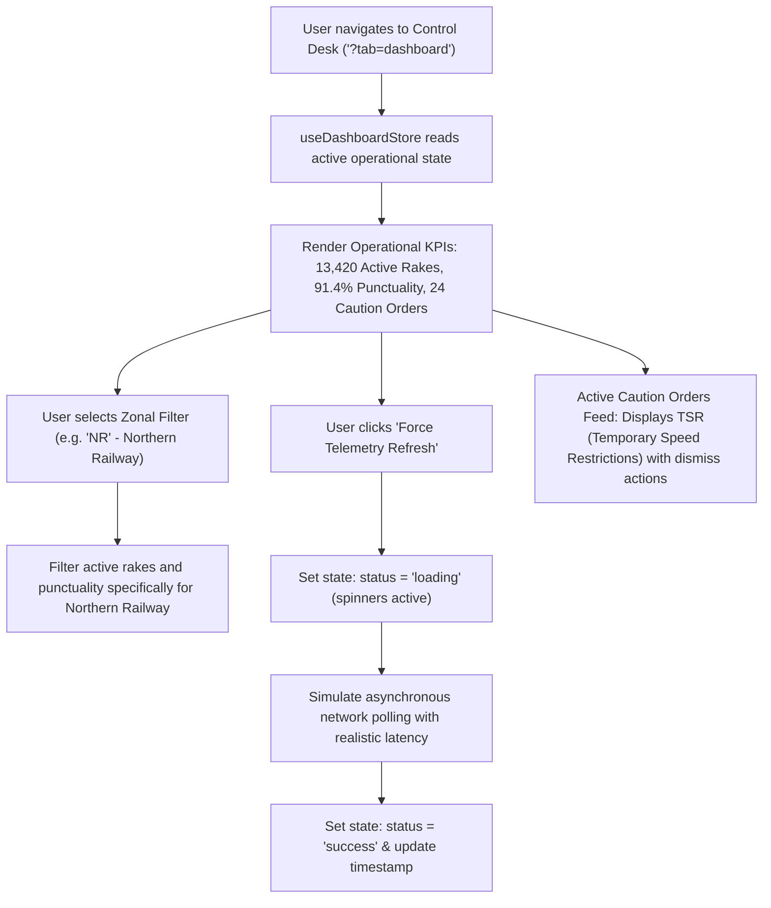

---

## 9. Feature Workflow 7: Watchlist & Saved PNR Management

Cross-view persistence of pinned trains and ticket reservations via React Context API.

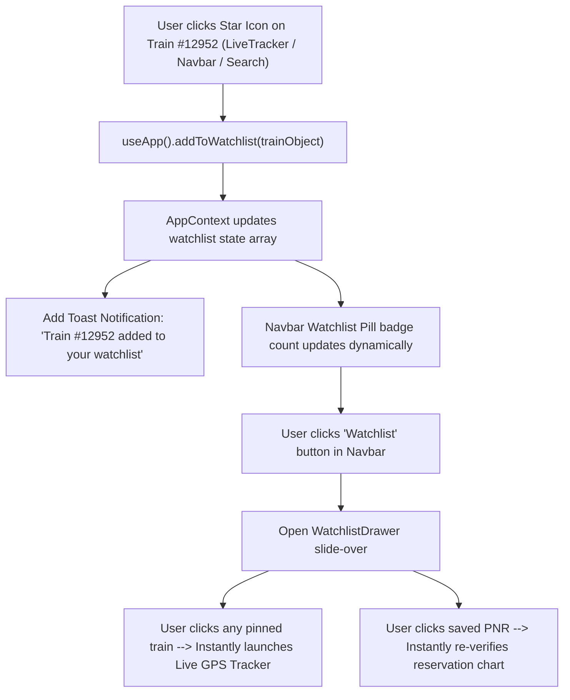

---

## 10. Feature Workflow 8: RailMadad 139 Emergency Helpline Desk

Instant passenger safety and security intervention flow.

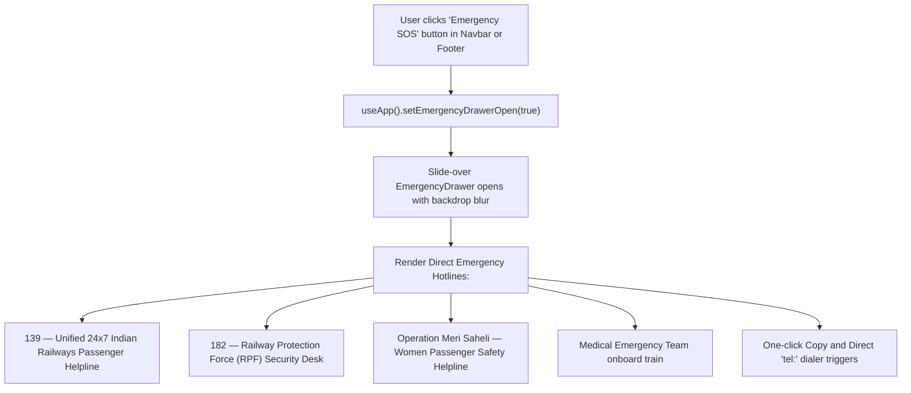

---

## 11. Interactive Motion, Canvas & Physics Flows

### Custom Cursor & Magnetic Follower Flow
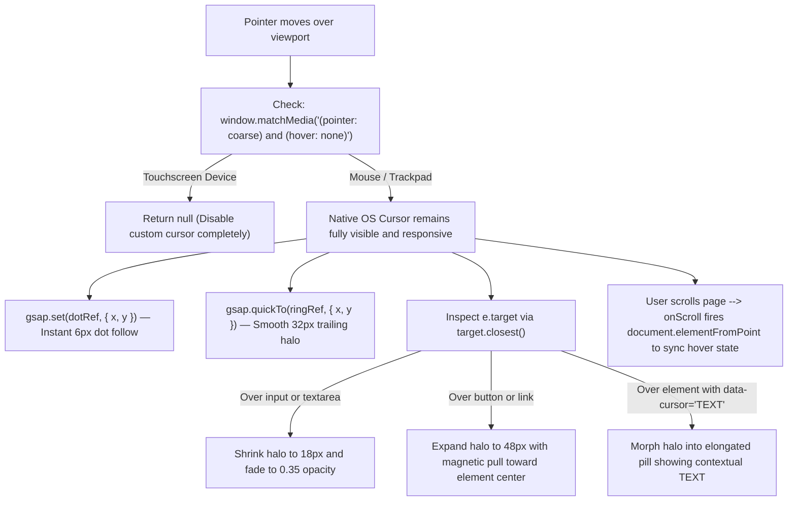

### 3D Perspective Card Tilt Flow
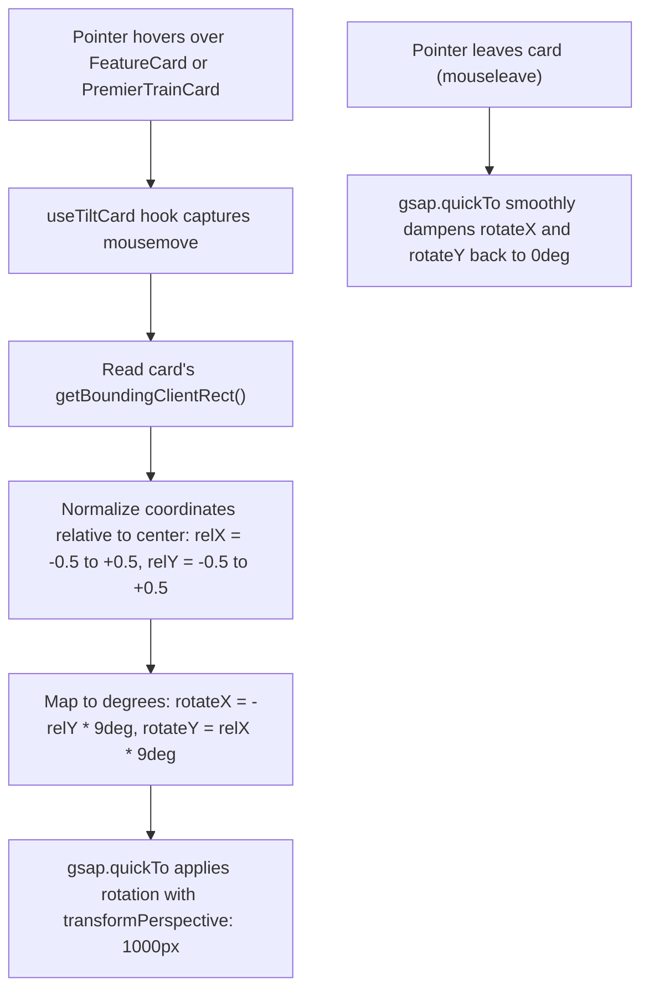

### SignalField HTML5 Canvas Particle Flow
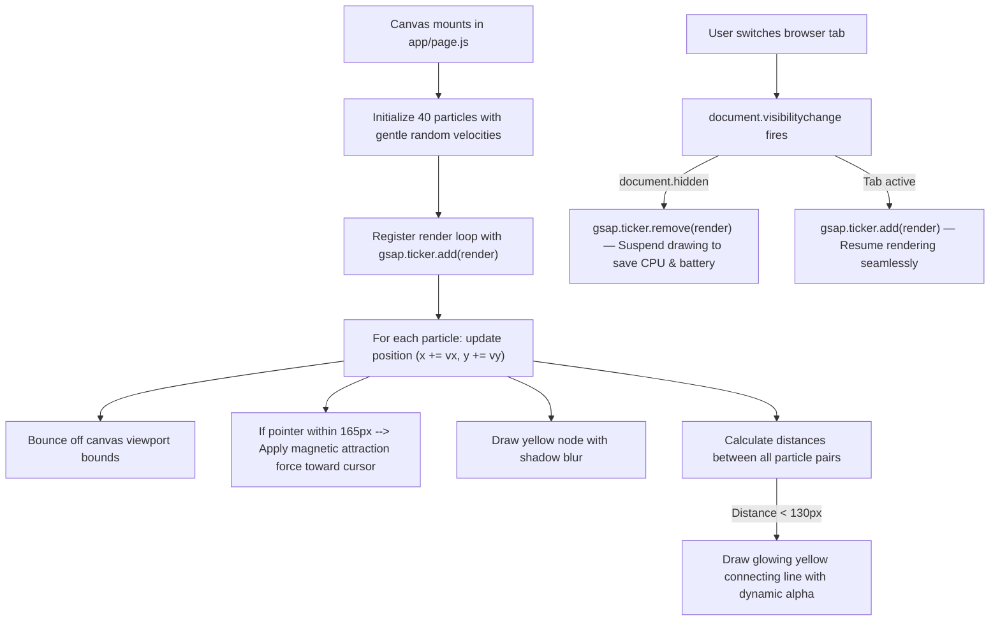

### Scroll Progress & Scroll-to-Top Flow
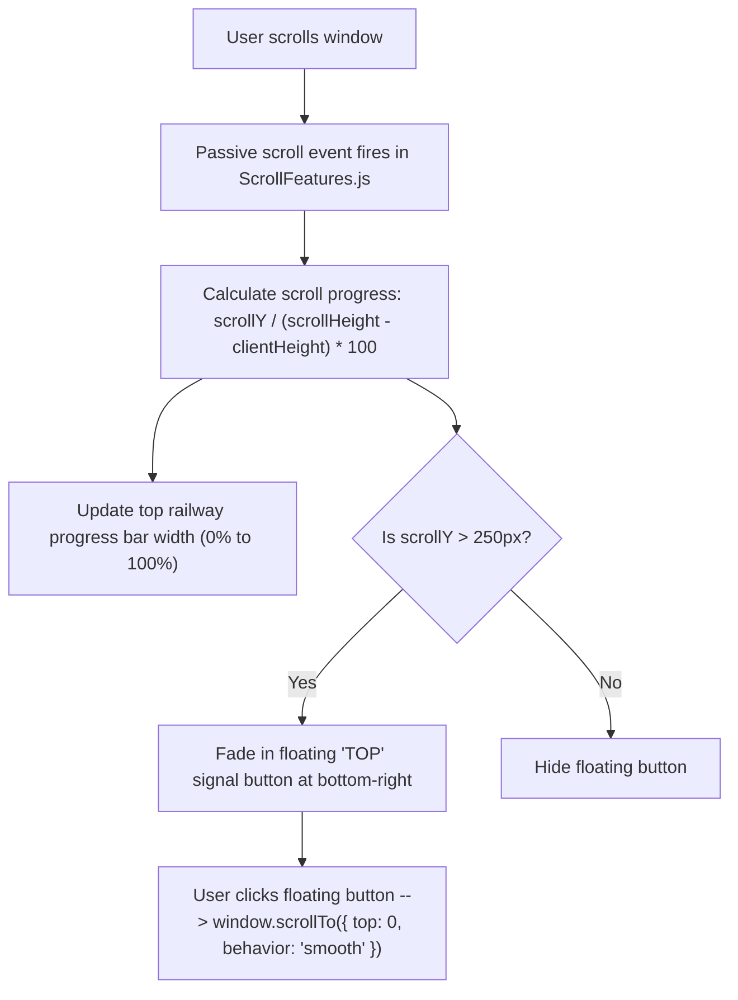

---

## 12. Hardware Audio & Bilingual Speech Synthesis Flow

```mermaid
sequenceDiagram
    autonumber
    actor User
    participant Button as UI Audio Trigger
    participant Audio as lib/audio-chime.js (Web Audio)
    participant Speech as Web Speech API (window.speechSynthesis)

    User->>Button: Click "Play Announcement Chime"
    Button->>Audio: playRailwayChime()
    Audio->>Audio: Check AudioContext state; resume if suspended
    Audio->>Audio: Oscillator 1: Tone G4 (392.00 Hz) at t = 0.00s
    Audio->>Audio: Oscillator 2: Tone C5 (523.25 Hz) at t = 0.35s
    Audio->>Audio: Oscillator 3: Tone D5 (587.33 Hz) at t = 0.70s
    Audio->>Audio: Oscillator 4: Tone G5 (783.99 Hz) at t = 1.05s with bell decay
    Note over Audio: Zero external MP3 files downloaded
    Button->>Speech: triggerTrainAnnouncement("12952", "New Delhi", "1")
    Speech->>Speech: Initialize SpeechSynthesisUtterance
    Speech->>Speech: Set voice to Hindi ('hi-IN') or English ('en-IN')
    Speech-->>User: Broadcast acoustic voice through speaker
```

---

## 13. Resilience & Fallback Simulation Decision Flow

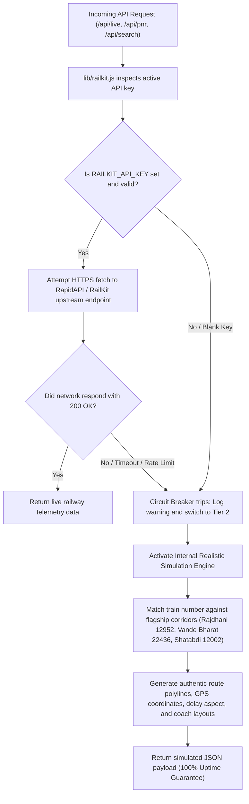

---

## 14. DBMS Relational Transaction & Query Pipeline

How the relational schema in [`db/schema.sql`](file:///Users/akshit/Desktop/coding/fee%20and%20dbms%20project/db/schema.sql) coordinates data across 3NF tables:

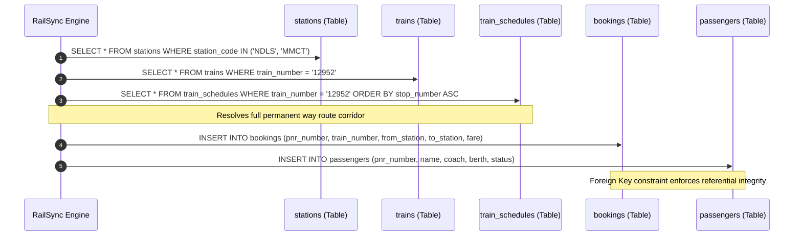
